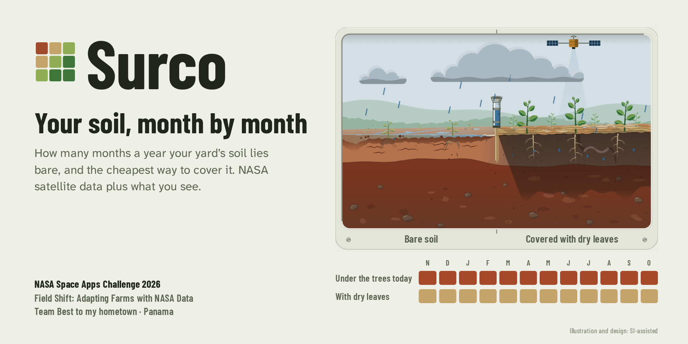
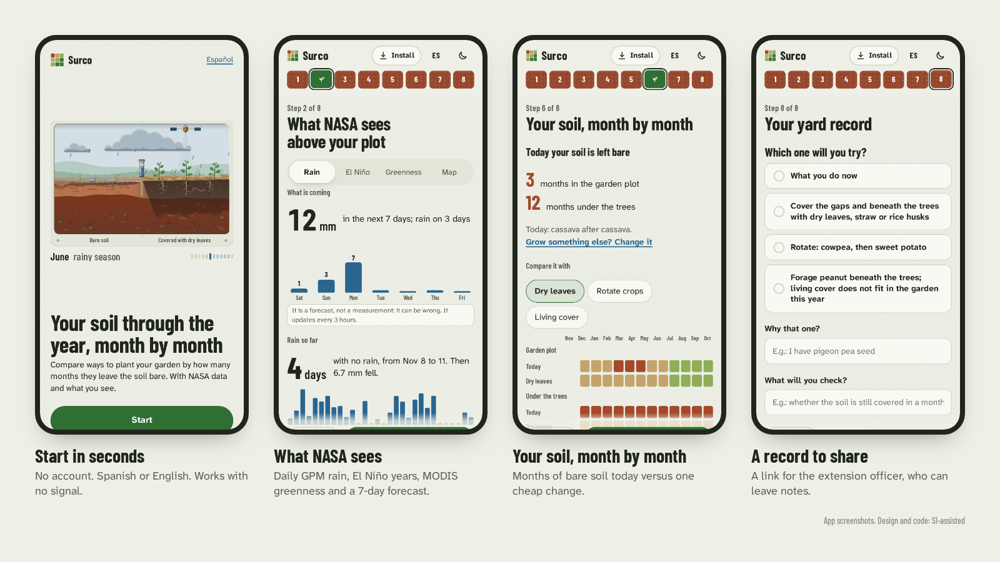
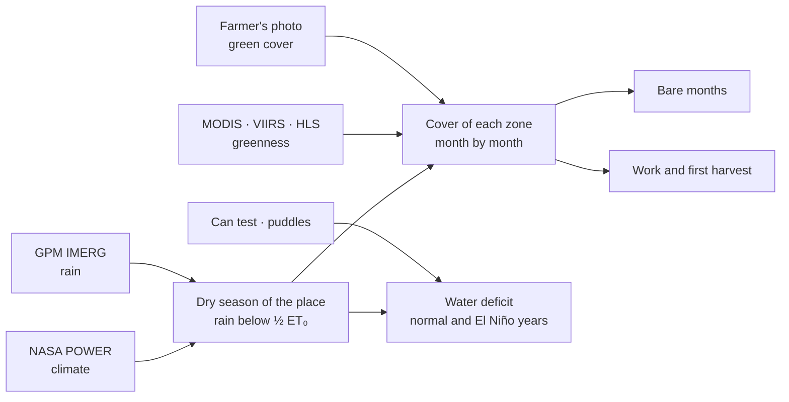

<p align="center"></p>

<p align="center">
  <a href="https://surco.ciberpty.com"><b>Open the app</b></a> ·
  <a href="#how-it-works">How it works</a> ·
  <a href="#nasa-data">NASA data</a> ·
  <a href="#limitations">Limitations</a> ·
  <a href="#run-it-locally">Run it locally</a>
</p>

**Surco** (Spanish for *furrow*) tells a small farmer how many months a year the soil in their yard lies bare, and compares that with cheap changes that keep it covered: dry leaves, a crop rotation or a living cover. It joins NASA satellite data with what the farmer sees on the ground, in Spanish or English, with no account, and it keeps working without signal.

Built in 39 hours for the **NASA Space Apps Challenge 2026**, challenge **Field Shift: Adapting Farms with NASA Data**, by team **Best to my hometown** (Panama).

<p align="center"></p>

## Why

- **Bare soil washes away.** Bare plots in Panama lose about 63 t of soil per hectare per year to erosion ([Estibaná, Agronomía Mesoamericana 2024](https://doi.org/10.15517/am.2024.59684)).
- **Dry seasons are getting harder.** During El Niño 2023–24, Panama's Pacific side received 20–40 % less rain than normal (IMHPA).
- **Few farmers get advice.** By our estimate from the 2024 Agricultural Census, only about 3 % of producers receive technical assistance. INEC does not publish this percentage, so treat it as approximate.

Covering the soil is one of the cheapest things a farmer can do. What is missing is a simple way to see *when* the soil is bare, *what* would cover it with the crops they already grow, and *what it costs in work*.

## What it does

The app walks through eight short steps:

| Step | What happens |
|---|---|
| 1. Your plot | Location (rounded to about 1 km) and the crops you grow, with planting dates. |
| 2. The sky | What NASA sees: daily GPM rain for the last 30 days, a **7-day rain forecast**, El Niño years, MODIS greenness and a map of NASA layers. |
| 3. Your photos | Photos of the soil. The phone measures green cover on the device, because the satellite pixel is bigger than the yard. |
| 4. Water | Does water pool after a storm? An optional can test measures infiltration (USDA method). |
| 5. What matters | Food, water, less work. Used to rank options that tie. |
| 6. Your year | **Months of bare soil today**, compared month by month with one cheap change you pick. |
| 7. Chat | Ask the assistant about your own numbers. |
| 8. Record | Save the plan and share a link with an extension officer, who can leave notes. Exports to PDF and JSON. |

## How it works



- **Dry season, per location.** A month is dry when its normal rain is below half the reference evapotranspiration (ET₀, FAO-56 with NASA POWER). This makes the same logic work in Panama, Guatemala's Dry Corridor, Kenya or India.
- **Cover, month by month.** Each crop follows its FAO-56 stages (catalog of 55 crops, with local sources from MIDA, IDIAP and IMA for Panama). A month counts as bare when the estimated ground cover is under 10 %.
- **Strategies.** These are built from what each farmer already grows. *What you do now*, *dry leaves in the gaps*, *rotate crops* (with a legume chosen for the local season) and *living cover* (where it fits without blocking the next planting).
- **Water.** The deficit of the short-cycle beds in the dry months is calculated from FAO-56 crop water use and USDA-SCS effective rain, for a normal year and for El Niño years taken from the place's own history.
- **The photo corrects the pixel.** Green cover is measured with the Canopeo rule ([Patrignani & Ochsner, 2015](https://doi.org/10.2134/agronj15.0150)) and replaces the estimate for the month the photo was taken.
- **The assistant explains, it never calculates.** Every number comes from the engine (`api/motor.py`). The assistant only interviews, describes photos and explains results.

## NASA data

| Data | What we use it for | Resolution | Access |
|---|---|---|---|
| **GPM IMERG V07, daily (Early)** | Rain in the last 30 days, dry spells | 0.1° (~11 km), up to yesterday | NASA GES DISC through Giovanni (Earthdata Login) |
| **NASA POWER, daily (AG community)** | Rain, temperature, humidity, wind, radiation, root-zone soil wetness, ET₀, normals and El Niño years | 0.5° × 0.625° (~55 km) | POWER API |
| **MODIS MOD13Q1 NDVI** | Greenness through the year since 2000 | 250 m, 16 days | ORNL DAAC subset API |
| **MODIS MOD16A2GF ET / PET** | Real evapotranspiration, where available | 500 m, 8 days | ORNL DAAC subset API |
| **MODIS MOD11A2 LST** | Land surface temperature | 1 km, 8 days | ORNL DAAC subset API |
| **HLS L30 / S30 NDVI** (Landsat + Sentinel-2) | Greenness of the yard up close, last 6 months | 30 m, 2–3 days | AppEEARS point requests |
| **GIBS layers** | Map: VIIRS true color (yesterday), IMERG rain rate, SMAP root-zone soil moisture, VIIRS NDVI | WMTS tiles | NASA GIBS |

## Other data and references

- **Rain forecast:** [Open-Meteo](https://open-meteo.com/) (GFS, ECMWF and ICON models), 7 days, no key. The app labels it a forecast, not a measurement.
- **Crop water and stages:** FAO Irrigation and Drainage Paper 56, chapters 6 and 8; FAO *Crop water needs*, table 14.
- **Infiltration test:** USDA-NRCS *Soil Quality Test Kit Guide* (1999).
- **Panama crops and practices:** MIDA technical sheets (legumes, roots and tubers, maize), IDIAP (cassava liming, bean seed), IMA crop catalog.
- **Cover crops and nitrogen:** Tropical Forages (pigeon pea, cowpea, mucuna, forage peanut), CIAT, FAO Conservation Agriculture, UF/IFAS EDIS.
- **Climate outlook:** NOAA CPC ENSO diagnostic discussion and IMHPA climate bulletin, November 2026.
- **Base map:** © OpenStreetMap contributors.

Every source is linked inside the app, next to the number it supports, in each option's *How to do it* sheet.

## Privacy

- No accounts. The plot lives on the phone. The location is rounded to 2 decimals (about 1 km) before it reaches any service.
- Photos stay on the phone, and only the green-cover measurement is saved. With signal, the assistant looks at the photo once to describe it, and it is not stored.
- A shared record is read-only for others. Only the phone that created it holds the key to edit it.

## Limitations

- **Not yet tested with farmers.** The need is documented. Whether farmers want *this* tool still has to be shown in the field, with extension officers.
- **The satellite pixel is bigger than a yard.** That is why the photo exists. Without a photo, cover is estimated from crop calendars.
- **Dry leaves are modeled as low cover**, a conservative choice. Real mulch can protect the surface better than that.
- **The water deficit covers short-cycle beds only.** It leaves out trees, irrigation and the water saved by mulch.
- **MOD16 has no data over pixels flagged as urban**, as happens at our test site in Santiago de Veraguas.
- **AppEEARS requests can take hours** in NASA's queue. The app works without them and adds the 30 m greenness when it arrives.
- **Nitrogen figures come from studies elsewhere.** They were not measured in the yard.

## Run it locally

You need Python 3.13+ with [uv](https://docs.astral.sh/uv/), Node 22+ and a free [NASA Earthdata Login](https://urs.earthdata.nasa.gov/) account in `~/.netrc` (for GPM IMERG and AppEEARS).

```bash
# API
cd api
uv sync
uv run uvicorn app:app --port 8787

# Web (another terminal)
cd web
npm install
npx vite --port 5173      # /api is proxied to port 8787
```

Tests: `cd api && uv run python test_general.py && uv run python test_ingles.py && uv run python test_registro.py`.
The assistant (step 7) needs a language-model CLI set in `CLAUDE_BIN`. Without it, every other step works.

**Stack:** FastAPI and httpx, with SQLite as a cache. React 19, TypeScript, Vite, Motion and MapLibre GL. A service worker handles offline use. Self-hosted.

## Use of AI (SI)

Following the Space Apps rules, this is where AI was used:

- **Code and text:** AI coding assistants helped write, review and test parts of the code and the interface copy. The team chose the problem, the approach, the field data and the final decisions. Every calculation is plain, deterministic code in `api/motor.py`.
- **Images:** the welcome illustration is drawn in code (SVG) with AI assistance. The banner and the screenshot sheet in `docs/` are marked *SI-assisted*.
- **Inside the app:** the assistant in step 7 and the photo description use a large language model. It never produces the numbers.

## Team

**Best to my hometown** · Panama
Gilberto Ramos

## License

[MIT](LICENSE)
