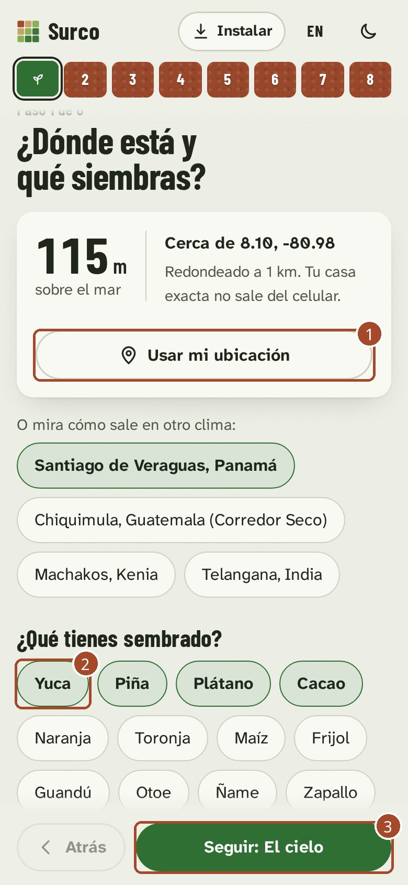
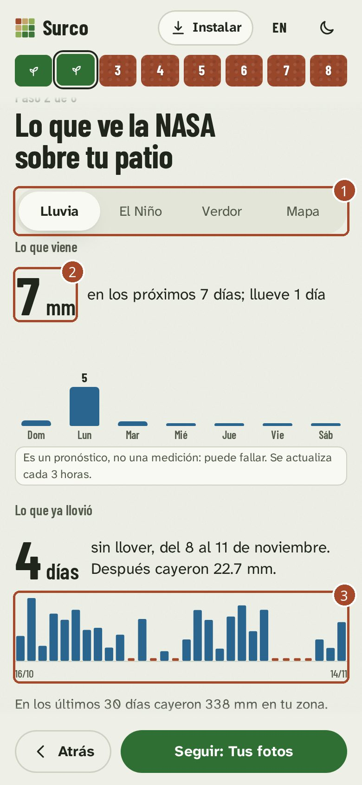
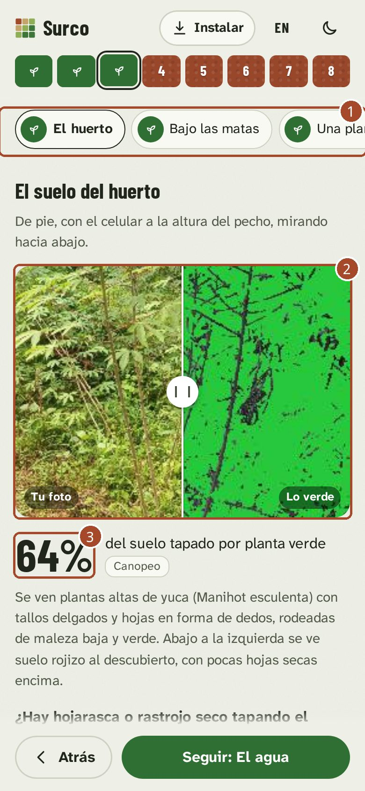
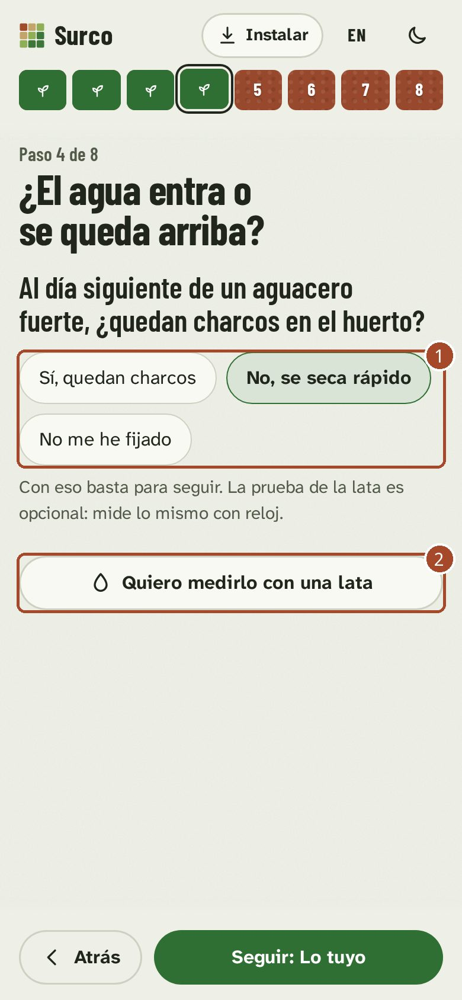
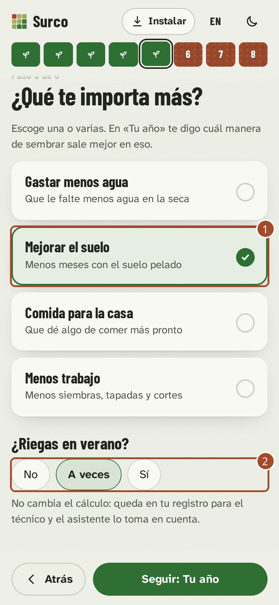
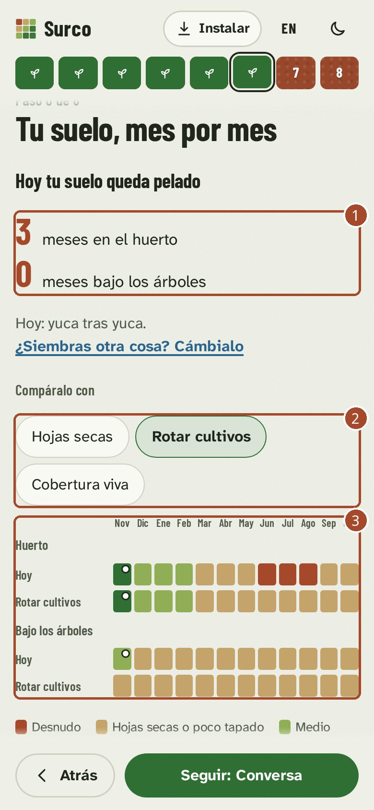
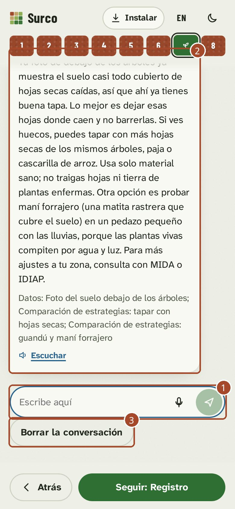
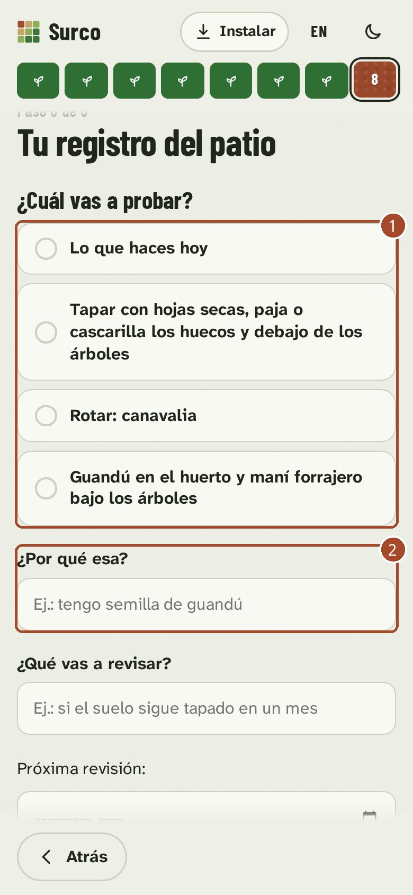
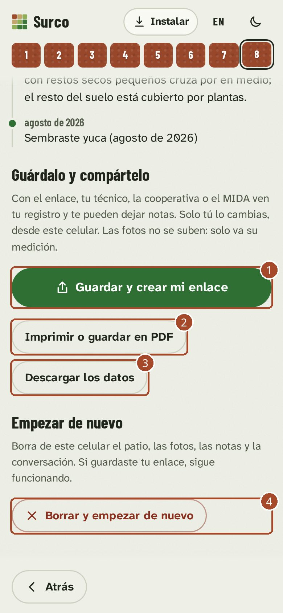

# Cómo usar Surco

Guía paso a paso con pantallas reales de https://surco.ciberpty.com (un patio en Santiago de Veraguas, Panamá, 15 de noviembre de 2026). Los números de cada pantalla corresponden a la lista de abajo.

Primero mira el video de 30 segundos (en inglés): https://surco.ciberpty.com/demo.mp4

**Qué necesitas:** un celular con navegador. Hace falta internet la primera vez, para los datos del satélite y para el asistente; después la app abre sin señal con lo último que vio. No hay que crear cuenta. Arriba están **Instalar** (pone Surco en tu pantalla de inicio), **ES / EN** (idioma) y la luna (modo oscuro). Todo lo que anotas se queda en tu celular hasta que decidas guardar un enlace en el paso 8.

English version: [GUIDE.md](GUIDE.md)

## Paso 1 · Tu patio

1. **Usar mi ubicación.** Se redondea a 1 km; tu casa exacta no sale del celular. También puedes probar un clima de ejemplo: Santiago de Veraguas, el Corredor Seco de Guatemala, Kenia o India.
2. **¿Qué tienes sembrado?** Toca cada cultivo. Si no está, escríbelo debajo de la lista. Más abajo dices cuándo sembraste cada uno; para árboles y matas que duran años escoge *Hace años*, y si no te acuerdas, déjalo en blanco.
3. **Seguir** te lleva al paso que viene. Los cuadros de arriba se vuelven un brote cuando el paso está listo, y puedes tocar cualquiera para saltar ahí.

## Paso 2 · El cielo: lo que ve la NASA sobre tu patio

1. **Cuatro pestañas.** *Lluvia*: el pronóstico y lo que ya llovió (GPM IMERG; NASA POWER mientras llega IMERG). *El Niño*: cuánto llovió en tus meses secos en los Niños fuertes de antes. *Verdor*: qué tan verde se ve tu patio (HLS, 30 m) y tu zona (MODIS, 250 m) desde el espacio. *Mapa*: el tamaño real del píxel de cada satélite alrededor de tu patio, con la capa más reciente de la NASA encima.
2. **La cifra que importa** en esa pestaña, con una frase que la explica.
3. **La gráfica**, con las fechas y la fuente debajo.

## Paso 3 · Tus fotos: el suelo que ves tú

1. **Qué foto.** El huerto, el suelo bajo las matas o los árboles, una planta que te preocupa y el patio entero. De pie, con el celular a la altura del pecho, mirando hacia abajo.
2. **Tu foto junto a *lo verde*.** Arrastra la manija para comparar. La parte verde se mide en tu celular con el método Canopeo; la foto no se guarda en ningún servidor.
3. **Porcentaje del suelo tapado por planta verde.** Con señal, el asistente describe la foto y dice si hay hojas secas tapando la tierra. Las hojas secas también protegen el suelo, así que Surco las cuenta como cobertura.

## Paso 4 · El agua: ¿entra o se queda arriba?

1. **Al día siguiente de un aguacero fuerte, ¿quedan charcos?** Con esta respuesta basta para seguir.
2. **Quiero medirlo con una lata** (opcional). Una guía con dibujos te enseña a medir cuánto tarda en entrar el agua de una lata. Al terminar, escribes los minutos.

## Paso 5 · Lo tuyo: ¿qué te importa más?

1. **Escoge una o varias:** gastar menos agua, mejorar el suelo, comida para la casa, menos trabajo. En el paso 6 te digo cuál manera de sembrar te conviene más.
2. **¿Riegas en verano?** No cambia el cálculo: queda en tu registro para el técnico y el asistente lo toma en cuenta.

## Paso 6 · Tu año: tu suelo, mes por mes

1. **Meses con el suelo pelado hoy**, en el huerto y bajo los árboles, contados por separado.
2. **Compáralo con** tapar los huecos con hojas secas, rotar cultivos o una cobertura viva.
3. **La tira mes a mes.** Cada cuadro es un mes: rojo es pelado, y de ahí va de poco tapado a bien tapado. *Cómo se hace* abre los pasos de la opción que escogiste, con una tira grande donde tocas un mes para ver qué hay sembrado; y *Cómo lo calculé* muestra los números y las fuentes.

## Paso 7 · Conversa: pregúntale al asistente

1. **Escribe o habla tu pregunta** (el micrófono). También puedes tocar una de las preguntas sugeridas.
2. **La respuesta** usa solo los números ya calculados para tu patio y dice qué datos usó. *Escuchar* la lee en voz alta. Si le cuentas algo nuevo de tu patio (un cultivo, una fecha de siembra), te propone guardarlo, y no cambia nada hasta que tocas *Guardar*.
3. **Borrar la conversación** borra solo el chat; tu patio, tus fotos y tus notas se quedan.

## Paso 8 · Registro: tu registro del patio

1. **¿Cuál vas a probar?** Escoge la opción para tu patio.
2. **Por qué esa, qué vas a revisar y cuándo.** Más abajo, tu bitácora guarda cada foto, nota y siembra con su fecha.

1. **Guardar y crear mi enlace.** Con el enlace, tu técnico, la cooperativa o el MIDA ven tu registro y te pueden dejar notas. Solo tú lo cambias, desde este celular. Las fotos no se suben: solo va su medición.
2. **Imprimir o guardar en PDF.**
3. **Descargar los datos** en un archivo JSON.
4. **Borrar y empezar de nuevo** borra de este celular el patio, las fotos, las notas y la conversación. Si ya guardaste tu enlace, sigue funcionando.
