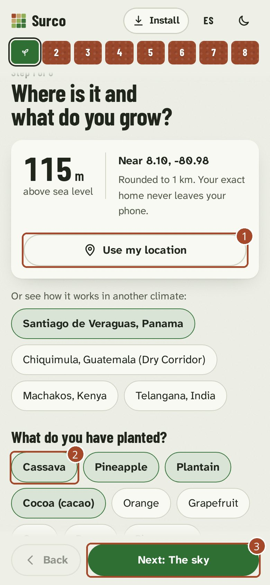
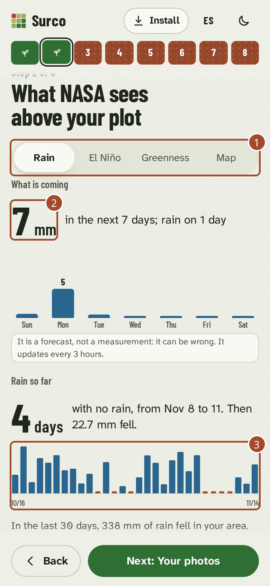
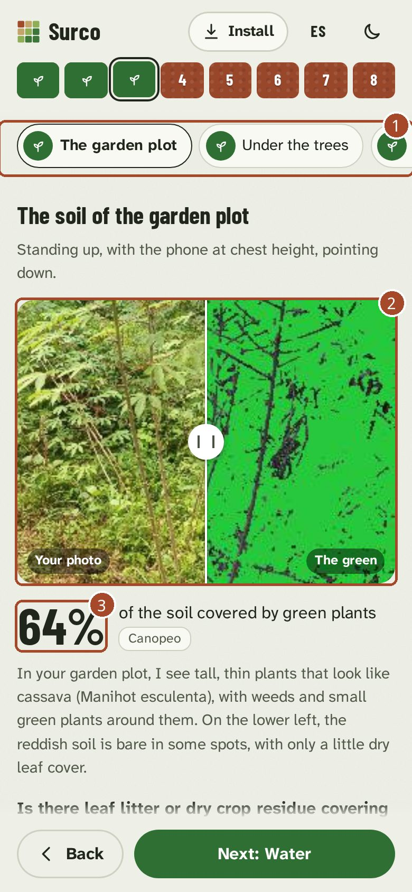
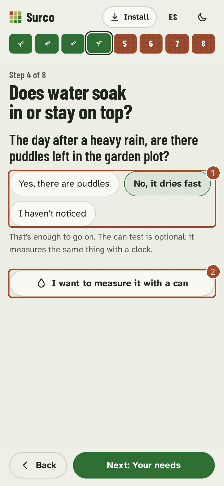
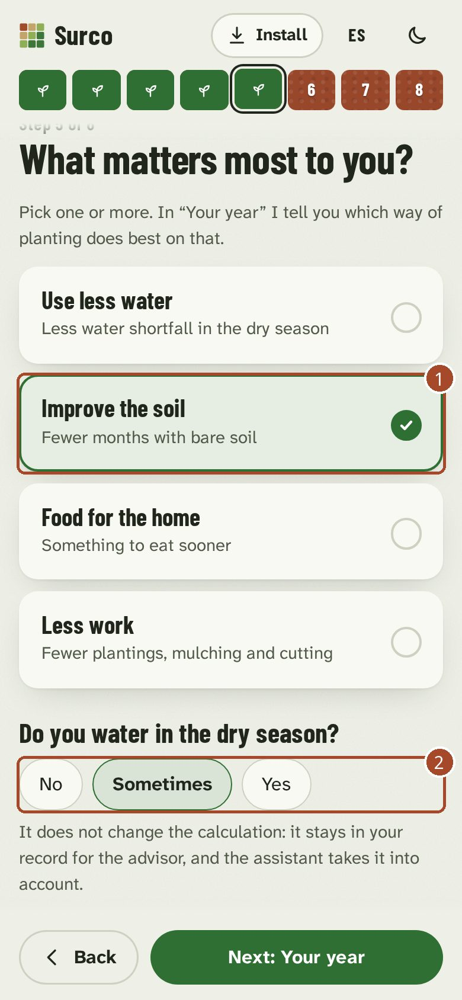
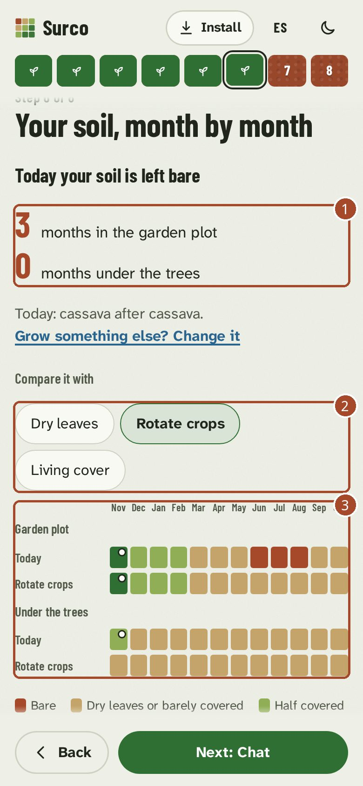
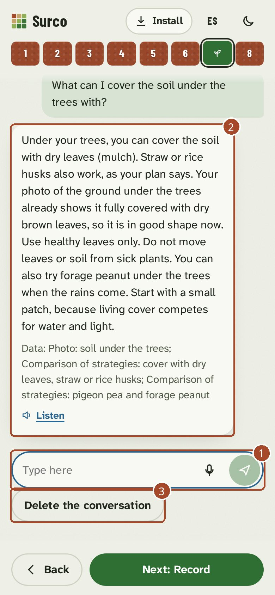
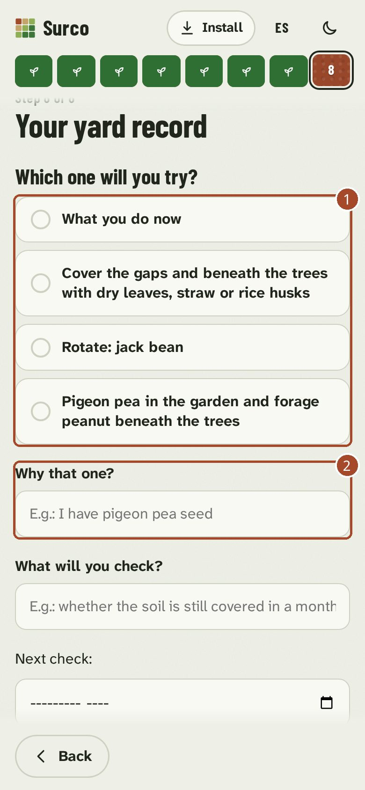
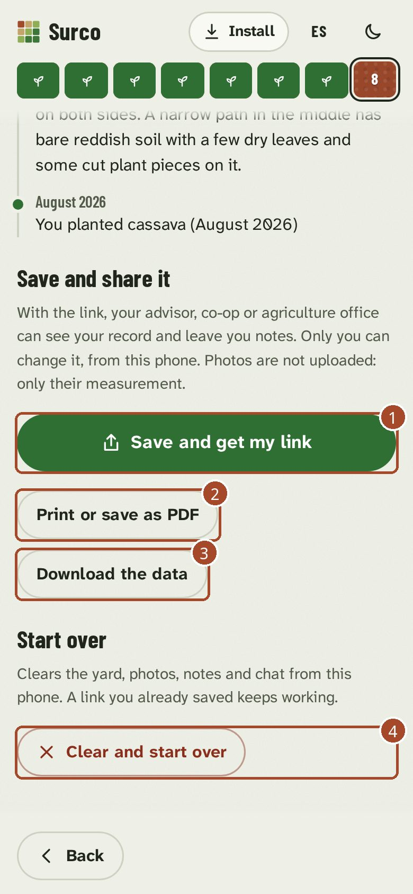

# How to use Surco

A step-by-step guide with real screens from https://surco.ciberpty.com (a yard in Santiago de Veraguas, Panama, 15 November 2026). The numbers on each screen match the list below it.

Watch the 30-second demo first: https://surco.ciberpty.com/demo.mp4

**What you need:** a phone with a browser. Internet is needed the first time, for the satellite data and for the assistant; after that the app opens without signal with the last data it saw. There is no account. The top bar has **Install** (adds Surco to your home screen), **ES / EN** (language) and the moon (dark mode). Everything you enter stays on your phone until you decide to save a link in step 8.

Versión en español: [GUIA.md](GUIA.md)

## Step 1 · Your plot

1. **Use my location.** It is rounded to about 1 km; your exact home never leaves your phone. You can also try an example climate: Santiago de Veraguas, the Dry Corridor of Guatemala, Kenya or India.
2. **What do you have planted?** Tap each crop. If yours is missing, type it under the list. Below, say when you planted each one; for trees and long-lived plants choose *Years ago*, and leave it blank if you don't remember.
3. **Next** takes you to the following step. The squares at the top turn into a sprout when a step is done, and you can tap any of them to jump there.

## Step 2 · The sky: what NASA sees above your plot

1. **Four tabs.** *Rain*: forecast and the rain that already fell (GPM IMERG; NASA POWER while IMERG arrives). *El Niño*: how much rain fell in your dry months in past strong El Niño years. *Greenness*: how green your yard (HLS, 30 m) and your area (MODIS, 250 m) look from space. *Map*: the real size of each satellite's pixel around your plot, with the latest NASA layer on top.
2. **The number that matters** for that tab, with a sentence that explains it.
3. **The chart**, with the date range and the source under it.

## Step 3 · Your photos: the soil you see

1. **Which photo.** The garden plot, the soil under the trees, a plant you are worried about, and the whole yard. Stand up and point the phone down at chest height.
2. **Your photo next to *the green*.** Drag the handle to compare. The green part is measured on your phone with the Canopeo method; the photo itself is not stored.
3. **Percent of soil covered by green plants.** With signal, the assistant describes the photo and says whether dry leaves cover the ground. Dry leaves also protect the soil, so Surco counts them as cover.

## Step 4 · Water: does it soak in or stay on top?

1. **The day after a heavy rain, are there puddles?** This answer is enough to go on.
2. **I want to measure it with a can** (optional). A picture guide shows how to time how long a can of water takes to soak in. Type the minutes when you are done.

## Step 5 · Your needs: what matters most to you?

1. **Pick one or more:** use less water, improve the soil, food for the home, less work. Step 6 uses this to tell you which option fits you best.
2. **Do you water in the dry season?** It does not change the calculation; it stays in your record for your advisor and for the assistant.

## Step 6 · Your year: your soil, month by month

1. **Bare months today**, in the garden plot and under the trees, counted separately.
2. **Compare it with** covering the gaps with dry leaves, rotating crops, or a living cover.
3. **The month-by-month strip.** Each square is a month: red is bare, then from barely covered to well covered. *How to do it* opens the steps for the option you picked, with a big strip where you tap a month to see what is planted then; and *How I worked it out* shows the numbers and sources behind it.

## Step 7 · Chat: ask the assistant

1. **Type or speak your question** (the microphone). You can also tap one of the suggested questions.
2. **The answer** uses only the numbers already calculated for your yard, and lists the data it used. *Listen* reads it aloud. If you tell it something new about your yard (a crop, a planting date), it offers to save it, and nothing changes until you tap *Save*.
3. **Delete the conversation** clears the chat only; your yard, photos and notes stay.

## Step 8 · Record: your yard record

1. **Which one will you try?** Pick the option for your yard.
2. **Why that one, what will you check, and when.** Your log below keeps each photo, note and planting with its date.

1. **Save and get my link.** Your advisor, co-op or agriculture office can open the record and leave you notes. Only you can change it, from this phone. Photos are not uploaded, only their measurement.
2. **Print or save as PDF.**
3. **Download the data** as a JSON file.
4. **Clear and start over** removes the yard, photos, notes and chat from this phone. A link you already saved keeps working.
